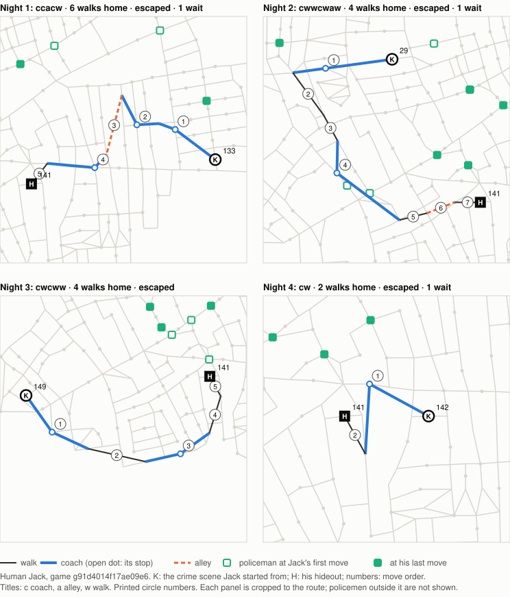
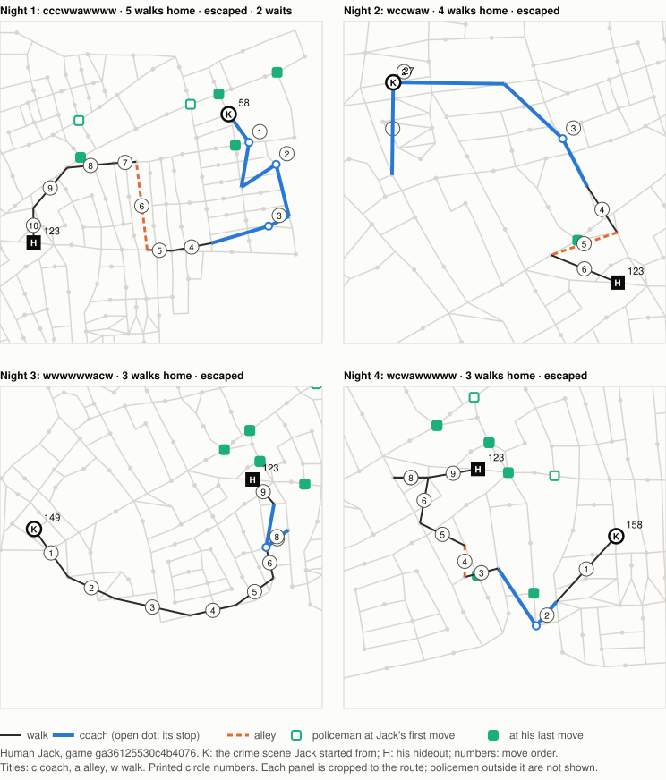
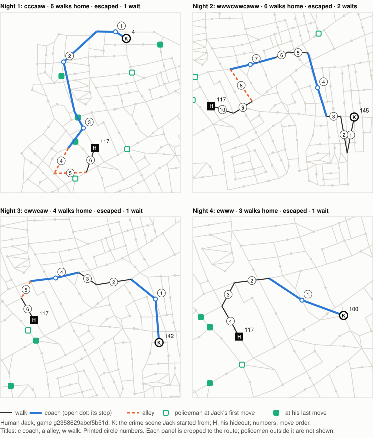
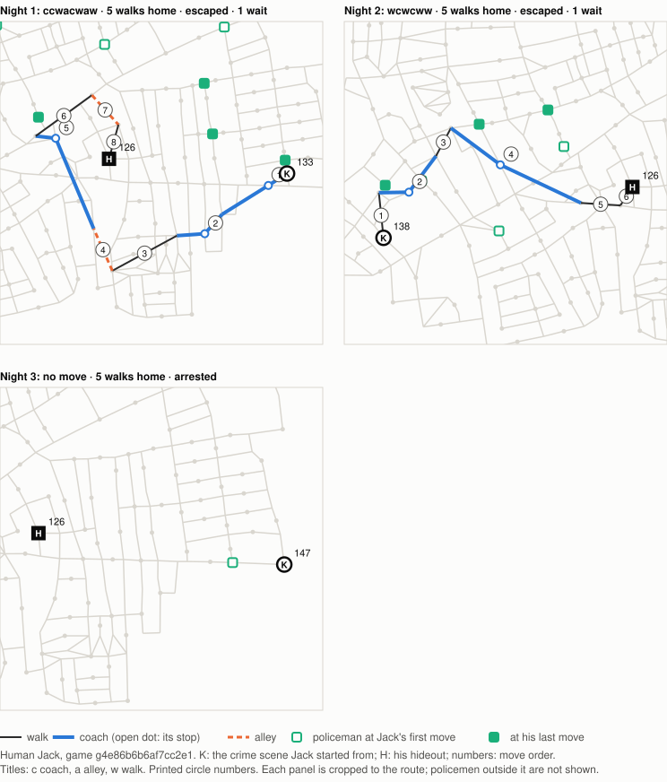
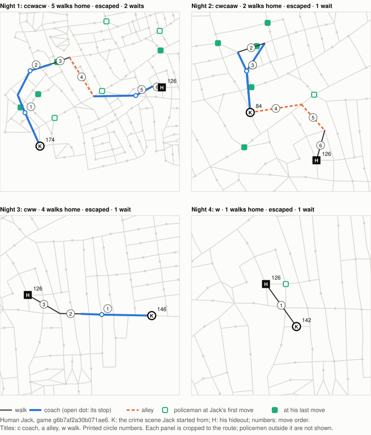
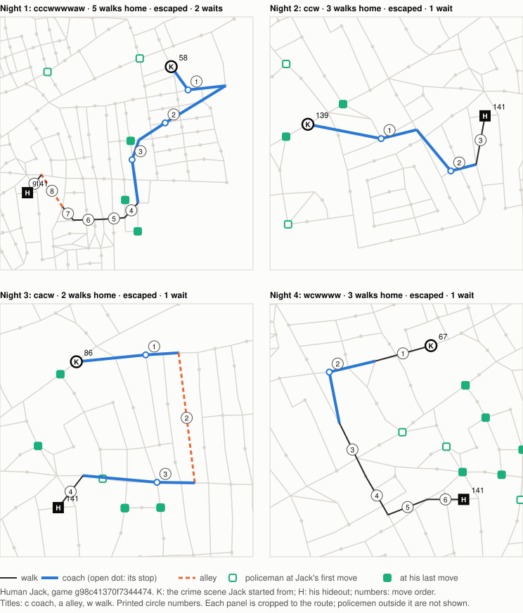
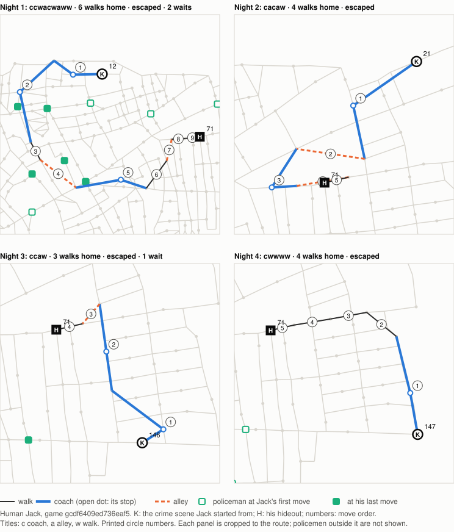
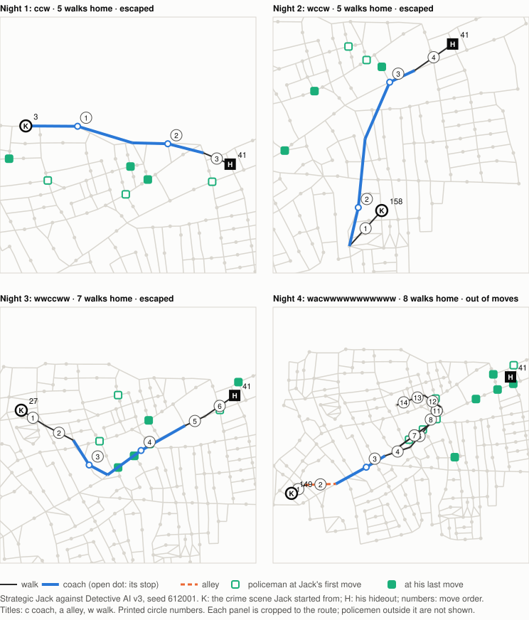
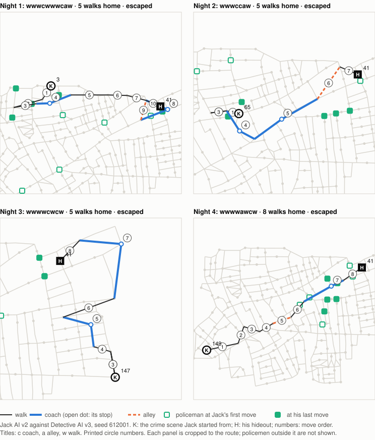

# Exploratory study: how Human Jack moves, against Strategic Jack and Jack AI v2

- **Date:** 2026-10-11 · **Type:** exploratory comparison (no finding is confirmed here) · **Methodology version:** 1
- **Question:** what observable differences exist between Human Jack's movement and our computer Jacks', and could they help explain why Detective AI v3 ranks Human Jack's true circle lower?
- **Human games:**
  - **Studied in full** (as the assignment names them): `g91d4014f17ae09e6` and `ga36125530c4b4076`, a person as Jack against Detective AI v3 (Normal), app 1.0.0, rule set `whitechapel-fff8e378d715`. Jack won both.
  - **Context only (first version):** the other five games in the collection were shown in a separate column and never pooled with these two. Repeated hideouts suggest they may be the same player.
  - **Update, the same day, at the owner's request:** the other five (`g2358629abcf5b51d`, `g4e86b6b6af7cc2e1`, `g6b7af2a30b071ae6`, `g98c41370f7344474`, `gcdf6409ed736eaf5`) are now traced the same way ([section 3b](#3b-the-other-five-human-games)). They are also added as an **all 7** column, shown alongside the two-game figures, which stand as first reported. Added analyses are marked *(update)*.
  - **Recording:** every game is already analysed (the [arrests investigation](2026-10-11-investigation-arrests.md) and [batch 1](2026-10-11-batch-1.md)), so nothing is registered in `analysis-state.json`.
- **Computer games:**
  - 25 games each for Strategic Jack (Normal) and Jack AI v2 (Hard), against Detective AI v3, seeds **612001–612025**.
  - They are the first 25 games of the [coach investigation](2026-10-11-investigation-coaches.md)'s control arm, regenerated identically. The same full-record pipeline and the same v3 configuration as the human games.
- **Reproduce:**
  - `node research/human-playtests/reports/2026-10-11-movement.js summary` (about 8 minutes) writes `results/movement-summary.json`;
  - `... figures` writes `figures/movement-*.svg`.
- **Builds on:**
  - [Coaches](2026-10-11-investigation-coaches.md): forcing early coaches didn't reduce v3's tracking. People are ranked lower on every night (5% in its top 10 on night 1, 21% on nights 2–4).
  - [Night-4 escape](2026-10-11-investigation-night4.md). The arrest policy and the coach habit are not re-tested.

## 1. Answer in brief

**Observed:**
- **Longer routes from nearer crime scenes.** The two human games started nearer home (median 4 walks, against 5–6) yet took longer routes: a median 4.5 track spaces over the fastest route home, against 1 for Strategic Jack and 3 for Jack AI v2. They never took the fastest route on any of 8 nights.
- **Coaches, early and not homeward.** People spent every coach, early in the night. Only a third of their coaches gained the two walks home a coach can buy (against about 80%), and a quarter ended farther from home (computer Jacks: almost never).
- **More alleys, and waiting.** People used about twice as many alleys, and waited on half their nights. The computer Jacks never waited.
- **No difference in how close the police got.** The police came just as close to every Jack: median 2 walks away, and within arrest reach before about 30% of moves for all.

**Possibly linked to v3's weaker tracking:**
- **Set size.** Human clue decisions fell in larger possible sets: median 67 circles, against 42–44.
- **Rank within sets of similar size.** Even there, v3 ranked people lower, and the gap was widest just after an ordinary walk: 6% in the top 10, against 16% (Strategic Jack) and 38% (Jack AI v2).
- **Cause not established.** Which movement difference, if any, causes this can't be told from two games. The evidence is **inconclusive**.

**Update: all seven human games.**
- **The two-game findings hold in every game.** All seven games, each taken alone, show:
  - longer routes than the fastest (+2 to +7 spaces; Strategic Jack +1);
  - every coach spent, early;
  - waiting on most nights;
  - Jack in v3's top 10 at 9–27% of decisions, against 36% and 43% for the computer Jacks.
- **Pooled over the seven games:** routes are +4 spaces over the fastest route. A fifth of the coaches lost ground (10 of 50). The police came no closer (within reach before 29% of moves).
- **New: what the non-homeward coaches accomplished.**
  - **Threatened starts are commoner:** human nights began with a policeman in reach on 9 of 26 nights, against 4 of 91 (Strategic Jack) and 10 of 95 (Jack AI v2).
  - **The response:** in 8 of those 9, the first move was a coach that left reach, and in 6 it ended farther from home.
  - **Where the lost ground comes from:** 8 of the 10 coaches that lost ground were the night's first move.
  - **Waits:** all 9 threatened starts followed a wait; 20 of the 26 nights had one.
  - **What this describes:** what the moves accomplished, not their intent.
- **On v3's tracking:** pooled, the seven games confirm the set-size part (63% of decisions over 50 possible circles, against 45–46%) and the within-size gap (21–50 circles: 10% against 22% and 38%). After walks the gap remains (5% against 16% and 38%). It is still **inconclusive** why.

**Status:** no defect, and no strategic weakness. Five patterns to watch (section 7). No AI was changed.

## 2. Method (brief)

**How each Jack move is measured.** Each move is taken from the full record, with the policemen where the record's police actions put them at that moment (the double event's extra police move included).
- **The board:** distances use the movement graph (`board.walk`, `board.alleys`).
- **The fastest route home:** the fewest move-track spaces, by a shortest-path search over the night's coaches and alleys left.
  - **Costs:** a walk costs 1, an alley 1, a coach 2. A coach can't end where it began.
  - **The end:** the night ends only by a walk onto the hideout.
  - **Two versions:** one ignoring the police, and one with walks blocked by the policemen where they stood (coaches and alleys pass them).
  - **Walled off:** when the policemen block every way home, the move is counted as "walled off", not as on or off the route.

**Police measures:**
- **Distance:** walks from Jack's circle to the nearest circle a policeman stands next to (the earlier reports' measure).
- **Within reach:** a policeman could stand next to Jack's circle after the police's next move (two crossings). This is the immediate threat.
- **Evasion:** a threatened move "left reach" if the circle it ended on was out of reach of the same policemen.

**What v3 believed:**
- **At every clue decision:** the earlier investigation's `study`, unchanged: possible circles, rank and probability of Jack's true circle, top 10.
- **Around each move:** the number of circles v3's deduction allows just before and just after it, from the police's view only.
- **What is compared:** strata of similar states, by the size of the possible set, the stage of the night and the kind of Jack's latest move. These are compared rather than raw pools, because the games differ.

**What Jack knew:** the measures use the board and the policemen's positions, which Jack sees. Nothing here infers his intent: a long route is reported as long, not as deception.

## 3. The two human games

| Game | Night | Crime scene → hideout | Walks home | Moves (c coach, a alley, w walk) | Spaces used / fastest | Waits | Nearest police (walks) |
|---|---|---|---:|---|---:|---:|---:|
| `g91d…` | 1 | 133 → 141 | 6 | 5 (ccacw) | 8 / 6 | 1 | 2 |
| | 2 | 29 → 141 | 4 | 7 (cwwcwaw) | 9 / 4 | 1 | 1 |
| | 3 | 149 → 141 (double event) | 4 | 5 (cwcww) | 7 / 4 | 0 | 2 |
| | 4 | 142 → 141 | 2 | 2 (cw) | 3 / 2 | 1 | 1 |
| `ga36…` | 1 | 58 → 123 | 5 | 10 (cccwwawwww) | 13 / 5 | 2 | 1 |
| | 2 | 27 → 123 | 4 | 6 (wccwaw) | 8 / 4 | 0 | 0 |
| | 3 | 149 → 123 (double event) | 3 | 9 (wwwwwwacw) | 10 / 3 | 0 | 1 |
| | 4 | 158 → 123 | 3 | 9 (wcwawwwww) | 10 / 3 | 0 | 1 |

**Observations:**
- **Coaches bought no time.** On every night the fastest route with the night's tokens was simply the walk home; coaches never shortened it.
- **Coaches that went the wrong way.** Ten of the 15 coaches gained fewer than two walks home, and 4 ended farther from home. Examples: `ga36…` night 1 went 5 → 7 → 7 → 5 walks over its first three coaches; `g91d…` night 3's first coach went 4 → 5.
- **Leaving an immediate threat.** Twice the night began with a policeman in reach (`g91d…` night 2, `ga36…` night 1), and the first coach left reach both times. That is what the move accomplished, whatever the reason for it.
- **Roundabout double events.** On both games' night 3 (crime scene 149 in each), Jack went the long way, through 174, 188, 190, 191 and 181, to a hideout 3–4 walks away.
- **Waiting next to home while walled off.** On `ga36…` night 4, Jack stood next to his hideout while the policemen walled off every walking route home. He stepped between circles 121 and 119, then walked home when the way cleared.
- **Waits.** Jack waited on 4 of 8 nights. In 3 of them the police's Wretched move left the victim one walk nearer home.

## 3b. The other five human games

*(update)*

| Game | Night | Crime scene → hideout | Walks home | Moves (c coach, a alley, w walk) | Spaces used / fastest | Waits (victim's walks home: before → at the murder) | Nearest police (walks) |
|---|---|---|---:|---|---:|---|---:|
| `g2358…` | 1 | 4 → 117 | 6 | 6 (cccaaw) | 9 / 6 | 1 (5 → 6) | 1 |
| | 2 | 145 → 117 | 6 | 10 (wwwcwwcaww) | 12 / 6 | 2 (8 → 6) | 2 |
| | 3 | 142 → 117 (double event) | 4 | 6 (cwwcaw) | 8 / 4 | 1 (5 → 4) | 2 |
| | 4 | 100 → 117 | 3 | 4 (cwww) | 5 / 3 | 1 (4 → 3) | 0 |
| `g4e86…` | 1 | 133 → 126 | 5 | 8 (ccwacwaw) | 11 / 5 | 1 (5 → 5) | 1 |
| | 2 | 138 → 126 | 5 | 6 (wcwcww) | 8 / 5 | 1 (5 → 5) | 2 |
| | 3 | 147 → 126 (double event) | 5 | none: arrested before moving | — | 0 | — |
| `g6b7a…` | 1 | 174 → 126 | 5 | 6 (ccwacw) | 9 / 5 | 2 (5 → 5) | 1 |
| | 2 | 84 → 126 | 2 | 6 (cwcaaw) | 8 / 2 | 1 (3 → 2) | 1 |
| | 3 | 146 → 126 (double event) | 4 | 3 (cww) | 4 / 4 | 1 (5 → 4) | 4 |
| | 4 | 142 → 126 | 1 | 1 (w) | 1 / 1 | 1 (2 → 1) | 1 |
| `g98c4…` | 1 | 58 → 141 | 5 | 9 (cccwwwwaw) | 12 / 5 | 2 (6 → 5) | 1 |
| | 2 | 139 → 141 | 3 | 3 (ccw) | 5 / 3 | 1 (4 → 3) | 1 |
| | 3 | 86 → 141 (double event) | 2 | 4 (cacw) | 6 / 2 | 1 (2 → 2) | 1 |
| | 4 | 67 → 141 | 3 | 6 (wcwwww) | 7 / 3 | 1 (2 → 3) | 1 |
| `gcdf6…` | 1 | 12 → 71 | 6 | 9 (ccwacwaww) | 12 / 6 | 2 (7 → 6) | 1 |
| | 2 | 21 → 71 | 4 | 5 (cacaw) | 7 / 4 | 0 | 2 |
| | 3 | 146 → 71 (double event) | 3 | 4 (ccaw) | 6 / 3 | 1 (4 → 3) | 3 |
| | 4 | 147 → 71 | 4 | 5 (cwwww) | 6 / 4 | 0 | 3 |

**Observations** (what the moves accomplished, not why):
- **Only two of 18 escaped nights took the fastest route,** both in `g6b7…`: night 3, and night 4, the one-move escape from 142 that the [night-4 investigation](2026-10-11-investigation-night4.md) traced to v3's own Wretched move. Elsewhere the routes ran 2–7 spaces long. The longest were `g98c…` night 1 (9 moves for a 5-walk return, +7) and `g2358…` night 2 (10 moves for 6 walks, +6).
- **Coaches that lost ground were first moves away from the police.** 6 of the 35 coaches ended farther from home, and 5 of those were the night's first move. In 4 of those 5, Jack began the night with a policeman in reach and the coach took him out of it:
  - `g6b7…` night 1: 174 → 113, 5 → 6 walks home;
  - `g98c…` night 1: 58 → 77, 5 → 7;
  - `g98c…` night 3: 86 → 70, 2 → 4;
  - `gcdf6…` night 1: 12 → 2, 6 → 8.
  - The same is true of the two first games' clearest case (`ga36…` night 1, 58 → 92: 5 → 7, leaving reach).
- **Waits were the rule:** 16 of 19 nights. When the police then moved the victim, she ended nearer home in 10 cases and farther in 2.
- **Under threat, these games behaved like the computer Jacks:** they left reach on 15 of 28 threatened moves (54%, against 44–50%).
- **The arrest:** `g4e86…` night 3 ended before Jack moved, with an arrest on the double event ([batch 1](2026-10-11-batch-1.md)).

**For comparison:** one representative computer game per Jack, the same seed (612001), against v3.

- **Strategic Jack goes home almost directly,** coaching where it saves walking.
- **Jack AI v2 walks away first** (its detours), then heads home, coaching later in the night.
- On night 4, Strategic Jack ran out of moves short of his hideout, with policemen around it.

## 4. Movement metrics

| Metric | Human, 2 games (8 nights) | Other 5 human games (19 nights) | *All 7 human games (27 nights; update)* | Strategic Jack (25 games, 91 nights) | Jack AI v2 (25 games, 95 nights) |
|---|---:|---:|---:|---:|---:|
| Jack wins | 2 of 2 | 4 of 5 | 6 of 7 | 8 of 25 | 17 of 25 |
| Crime scene to hideout, walks (median) | 4 | 4 | 4 | 6 | 5 |
| **Route efficiency:** spaces over the fastest route (median, escaped nights) | **4.5** | 3.5 | 4 | **1** | 3 |
| Nights on a fastest route | 0 of 8 | 2 of 18 | 2 of 26 | 38% | 3% |
| **Return speed:** moves to get home (median) | 6.5 | 6 | 6 | 4 | 7 |
| Moves nearer home / farther | 62% / 13% | 69% / 9% | 67% / 10% | 72% / 6% | 69% / 15% |
| Moves on a fastest route: ignoring the police / with them where they stood | 59% / 63% | 58% / 60% | 58% / 61% | 67% / 75% | 64% / 66% |
| Moves begun walled off from home | 8% | 0% | 3% | 17% | 3% |
| **Coaches** per night (allowed 3, 2, 2, 1) | 3, 2, 1.5, 1 | 3, 2, 1.4, 0.8 | 3, 2, 1.4, 0.8 | 1.8, 1.5, 1.4, 0.8 | 2.1, 1.5, 1.5, 0.9 |
| Alleys per night (allowed 2, 2, 1, 1) | 1, 1, 0.5, 0.5 | 1.6, 1, 0.6, 0 | 1.4, 1, 0.6, 0.2 | 0.3, 0.4, 0.3, 0.7 | 0.2, 0.5, 0.3, 0.5 |
| **Waiting:** waits per night (nights with a wait) | 0.6 (4 of 8) | 1.1 (16 of 19) | 0.9 (20 of 27) | 0 | 0 |
| **Police proximity:** walks from the nearest policeman (median); moves begun within reach | 2; 32% | 2; 28% | 2; 29% | 2; 31% | 2; 28% |
| **Evasion:** threatened moves that left reach (a walk out existed) | 7 of 17 (16 of 17) | 15 of 28 (23 of 28) | 22 of 45 (39 of 45) | 44% of 176 (66%) | 50% of 193 (66%) |
| Unthreatened moves that went farther from the police | 28% | 27% | 28% | 16% | 24% |
| **Detective inference:** Jack in v3's top 10, at clue decisions | **12%** of 235 | 17% of 436 | 15% of 671 | **36%** of 2,516 | **43%** of 3,144 |
| Possible circles (median) | 67 | 59 | 62 | 42 | 44 |

**Carriage timing and effect** (each coach, by what it accomplished; no labels of intent):

| Coaches | Human, 2 games (15) | Other 5 (35) | *All 7 (50)* | Strategic Jack (129) | Jack AI v2 (143) |
|---|---:|---:|---:|---:|---:|
| Position in the night (median; 0 = first move, 1 = last) | 0.2 | 0.2 | 0.2 | 0.4 | 0.67 |
| On the night's first move | 33% | 40% | 38% | 23% | 10% |
| Gained two walks home (as good as two walks) / one / none / lost ground | 33 / 20 / 20 / **27%** | 37 / 29 / 17 / 17% | 36 / 26 / 18 / 20% | 79 / 19 / 2 / **0%** | 85 / 13 / 2 / **1%** |
| On a fastest route home (with the police where they stood) | 27% | 37% | 34% | 77% | 78% |
| Ended farther from the nearest policeman | 47% | 51% | 50% | 35% | 29% |
| Began within reach / left reach | 3 / 2 | 14 / 10 | 17 / 12 | 48 / 24 | 60 / 32 |
| v3's possible circles, after ÷ before (median) | ×3.5 | ×3.5 | ×3.5 | ×5.6 | ×2.5 |

For comparison, a walk multiplies v3's possible circles by 1.4–1.8 (median), in every group.

**The night's first move after a threatened start** *(update)*:

| | Human, 2 games | Other 5 | All 7 | Strategic Jack | Jack AI v2 |
|---|---:|---:|---:|---:|---:|
| Nights with a move | 8 | 18 | 26 | 91 | 95 |
| Begun with a policeman in reach | 2 | 7 | **9** | 4 | 10 |
| … the first move a coach / it left reach / it ended farther from home | 2 / 2 / 2 | 6 / 6 / 4 | **8 / 8 / 6** | 4 / 3 / 0 | 6 / 5 / 1 |
| Coaches that lost ground: in all / on the first move / leaving reach | 4 / 3 / 2 | 6 / 5 / 4 | **10 / 8 / 6** | 0 / 0 / 0 | 1 / 0 / 1 |

- **Every threatened human start followed a wait.** That is 9 of 9, while 20 of the 26 human nights with a move had one; the computer Jacks never wait.
- **A possible mechanism:** v3 moves a waited-for victim towards its real patrols ([night-4 investigation](2026-10-11-investigation-night4.md)), which would start the night near a policeman. This is an association in seven games, not a measured effect.

**Each human game on its own** *(update)*:

| Game | Hideout | Result | Spaces over the fastest (median) | Coaches that lost ground | Alleys | Waits | Jack in v3's top 10 (decisions) | Possible circles (median) |
|---|---:|---|---:|---:|---:|---:|---:|---:|
| `g91d4014f17ae09e6` | 141 | Jack | 2.5 | 2 of 8 | 2 | 3 | 9% (80) | 60 |
| `ga36125530c4b4076` | 123 | Jack | 7 | 2 of 7 | 4 | 2 | 14% (155) | 80 |
| `g2358629abcf5b51d` | 117 | Jack | 3.5 | 1 of 8 | 4 | 5 | 17% (115) | 100 |
| `g4e86b6b6af7cc2e1` | 126 | Police (night 3) | 4.5 | 0 of 5 | 2 | 2 | 10% (61) | 65 |
| `g6b7af2a30b071ae6` | 126 | Jack | 2 | 2 of 6 | 3 | 5 | 11% (65) | 45 |
| `g98c41370f7344474` | 141 | Jack | 4 | 2 of 8 | 2 | 5 | 16% (95) | 67 |
| `gcdf6409ed736eaf5` | 71 | Jack | 3 | 1 of 8 | 5 | 3 | 27% (100) | 51 |

Every game falls on the same side of the computer Jacks:
- **Route length:** +2 spaces or more over the fastest route, against Strategic Jack's +1.
- **Alleys:** 2 to 5 per game, against about 1.6 per computer game.
- **Waiting:** in every game; the computer Jacks never wait.
- **Tracking:** Jack in v3's top 10 at 9–27% of decisions, against 36% and 43%.

The games share hideouts (126 twice, 141 twice), so this agreement may reflect one player's habits.

**Matching:** only 3 computer nights per Jack began 1–3 walks from home, against 3 of the 8 human nights. So matching on that distance is impractical.

| Crime scene 4–6 walks from home | Nights | Moves home (median) | Spaces over the fastest |
|---|---:|---:|---:|
| Human, 2 games | 5 | 6 | 4 |
| *All 7 human games (update)* | 16 | 6 | 4 |
| Strategic Jack | 54 | 4 | 1 |
| Jack AI v2 | 64 | 7 | 4 |

At this distance the human routes match Jack AI v2's in length, not Strategic Jack's.

## 5. Detective v3's predictions in comparable states

Jack's true circle in v3's top 10 at clue decisions, within bands of the same possible-set size (decisions in brackets):

| Possible circles | Human, 2 games | Other 5 | *All 7 (update)* | Strategic Jack | Jack AI v2 |
|---|---:|---:|---:|---:|---:|
| 1–20 | 54% (37) | 84% (75) | 74% (112) | 88% (861) | 92% (918) |
| 21–50 | 6% (35) | 12% (102) | 10% (137) | 22% (496) | 38% (802) |
| 51–100 | 8% (79) | 0% (160) | 3% (239) | 3% (596) | 21% (695) |
| over 100 | 0% (84) | 0% (99) | 0% (183) | 3% (563) | 6% (729) |
| *Share of decisions with more than 50 possible* | *69%* | *59%* | *63%* | *46%* | *45%* |

Within 21–100 possible circles, by the kind of Jack's latest move:

| Latest move | Human, 2 games | Other 5 | *All 7 (update)* | Strategic Jack | Jack AI v2 |
|---|---:|---:|---:|---:|---:|
| Walk | **6%** (52) | 5% (100) | 5% (152) | **16%** (650) | **38%** (1,075) |
| Coach | 11% (45) | 2% (103) | 5% (148) | 4% (362) | 12% (334) |
| Alley | 0% (17) | 8% (59) | 7% (76) | 11% (80) | 6% (88) |

The probability v3 gave the true circle (median) was 0.004 for the human games, against 0.012 (Strategic Jack) and 0.022 (Jack AI v2), with medians of 67, 42 and 44 possible circles.

**Reading:**
- **Part of the gap is set size.** More of the human decisions fall in large sets (69% over 50 circles, against 45–46%), where v3 finds no Jack well.
- **Part is not.** Within the same bands, v3 still ranked people below Jack AI v2, by most just after an ordinary walk. Against Strategic Jack the bands are mixed (6% against 22%, but 8% against 3%).
- **After coaches, every Jack is hard to place.**
- *(update)* **Pooled over all seven games:**
  - **Against Jack AI v2:** the picture is the same. People are ranked lower in every band, and most clearly after walks.
  - **Against Strategic Jack:** the over-50 bands now agree (3% against 3%, 0% against 3%). The human gap with Strategic Jack therefore sits in small and middle-sized sets, and in how often people's sets are large.
- **Not shown:** a low probability on the true circle is not proof that the deduction is wrong. Every one of these sets contains the truth, and real uncertainty explains much of it.

## 6. The five questions

1. **Route efficiency and timing: yes, a visible difference.**
   - **Observed:** the human nights were longer than the fastest route by 4.5 spaces (median), against 1 (Strategic Jack) and 3 (Jack AI v2), and never the fastest. At comparable distances they resemble Jack AI v2's, not Strategic Jack's.
   - **Interpretation:** human routes cost moves the way Jack AI v2's detours do, but in a different shape: early coaches that don't head home, roundabout double events, and waiting near home when walled off.
   - *(update)* **All seven games agree:** every game ran +2 spaces or more over the fastest route; pooled, +4, with 2 of 26 nights on a fastest route.
2. **Coaches: yes, used differently.**
   - **Observed:** every token was used, early in the night (median position 0.2, against 0.4 and 0.67). Only a third gained two walks home (against about 80%), and a quarter lost ground (against almost none). They ended farther from the police more often (47% against 29–35%).
   - **On v3's uncertainty:** the coaches widened v3's possible set by ×3.5, between Strategic Jack's ×5.6 and Jack AI v2's ×2.5. They did not widen it more than the computer's.
   - *(update)* **What the coaches that lost ground accomplished:** over all seven games, 8 of the 10 were the night's first move, and 6 began with a policeman in reach and left it. So most "non-homeward" coaches were moves out of an immediate threat at the crime scene, not wandering in mid-route. Nights that began under threat were much commoner for people (9 of 26, against 4 of 91 and 10 of 95), and all followed a wait.
3. **Responding to the police: inconclusive.**
   - **Observed:** when threatened, the human games left reach no more often than the computer Jacks (7 of 17, against 44–50%), although a walk out existed more often. When not threatened, they moved away from the police slightly more often (28% against 16–24%). The two clearest responses are single episodes: the first coaches that left reach, and the waiting next to home while walled off.
   - **Why inconclusive:** 17 threatened moves can't separate these rates.
   - *(update)* **With all seven games,** people left reach on 22 of 45 threatened moves (49%), the same as the computer Jacks (44–50%). The one clear difference is at the start of the night, above, where people met a threat more often and coached out of it almost every time.
4. **Does Jack AI v2 trade efficiency or safety for concealment? Efficiency, not safety.**
   - **Efficiency:** it spends 3 spaces over the fastest route against Strategic Jack's 1, and takes the fastest route on 3% of nights against 38%.
   - **Safety:** its exposure is no worse (within reach before 28% of moves, against 31%; when threatened it left reach 50% of the time, against 44%), and it won 17 of 25 against 8 of 25.
   - **Caveat:** this agrees with the earlier studies; it is not a new test.
5. **Do the movement differences explain v3's weaker predictions? Possibly in part; not established.**
   - **Plausibly linked:** more human decisions sit in large possible sets, consistent with more alleys, all coaches spent, and longer nights.
   - **Not explained:** within sets of the same size, people are still ranked lower than Jack AI v2, mostly after ordinary walks. Nothing measured here explains that.
   - **Limits:** two games from probably one player can't tell which difference matters.
   - *(update)* **All seven games:** they share the larger sets (63% of decisions over 50 circles) and the low rank after walks (5%). The answer is unchanged: plausible in part, and inconclusive.

## 7. Conclusions

- **Patterns to watch** (none confirmed; no defect, no strategic weakness):
  1. human coaches that don't head home;
  2. human routes 3–5 spaces longer than needed, from crime scenes nearer home;
  3. waiting, which the computer Jacks never do;
  4. v3's low rank of human Jacks after walks, within sets of comparable size;
  5. *(update)* human nights starting with a policeman in reach after a wait, answered by a coach out of reach (9 and 8 of 26 nights).
- **The police's proximity doesn't differ.** People weren't tracked worse because the police stood farther away.
- **No AI was changed**, and none is proposed.

**Follow-up questions** (at most three; none commissioned):
1. **A calibration check:** for human records against computer ones, compare how much belief v3's top 10 held with how often Jack was there, split by set size and by the kind of the latest move. This would show whether v3 is overconfident specifically after human walks. (The coach investigation proposed the same check; this narrows it.)
2. **How v3 weighs the walks Jack actually chose:** v3 splits weight equally between successors. Compare the weight it gave the human's actual walk with the weight it gave the computer's, offline, from these records.
3. **Repeat this comparison with more players,** before generalising any of it. *(update)* All seven games now point the same way, but they probably share a player.

## 8. Limitations

- **Two human games,** probably one player (and five more that may be the same person). *(update)* Seven games in all, with repeated hideouts. Agreement between them may be one player's consistency, not a human trait. No statistical tests are reported. Percentages over 8 nights or 15 coaches are descriptions, not estimates.
- **25 computer games per Jack:** enough to describe them, not to resolve small differences.
- **Different situations.** The human crime scenes were nearer home than the computer's, and matching on that distance was impractical; the human double events, waiting and walled-off nights have few computer counterparts. Comparisons are by stratum where possible, and raw pools are labelled as such.
- **"Within reach" is a two-crossing rule;** the policemen's real next moves are not modelled. The police-aware fastest route treats them as standing still.
- **The figures show police positions at two moments only** (Jack's first and last move), cropped to the route.
